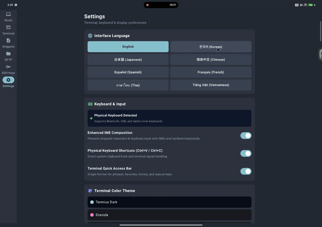

# TermiPlus

**SSH & 로컬 터미널 클라이언트 for Android**

안드로이드에서 SSH 서버에 접속해 터미널을 쓰고, 원격 파일을 살펴보고, 자주 쓰는 명령을 골라 쓰기 위한 앱입니다.

> **물리 키보드 + 구글 키보드(Gboard)로 한글을 입력해도 깨지지 않습니다.**
> 다른 클라우드 터미널 앱들은 물리 키보드에 구글 키보드(Gboard)를 붙여 쓰면 한글 조합 입력이 제대로 되지 않았습니다. TermiPlus는 그 문제를 해결해 **물리 키보드 + 구글 키보드(Gboard) 환경에서 한글 입력이 완벽하게 호환**됩니다.

같은 설계 덕분에 한글만이 아니라 **일본어(가나 입력·한자 변환), 중국어(병음·주음), 베트남어(Telex/VNI)** 처럼 조합(Composing)과 변환 후보창이 필요한 입력기도 물리 키보드에서 정상적으로 입력됩니다. 터미널 화면에 텍스트 편집 영역을 붙이지 않고 입력 타입을 `TYPE_NULL`로 두는 앱에서는 IME가 조합을 시작할 곳이 없어 이런 입력이 깨지거나 후보창이 뜨지 않습니다. TermiPlus는 터미널도 하나의 텍스트 편집 영역으로 취급해, 한글과 **완전히 같은 `InputConnection` 조합 경로**로 입력을 받습니다.

블루투스·USB·태블릿 커버 같은 **물리 키보드**를 붙여 쓰는 것을 전제로 만들어졌고, **한국어 IME(조합 입력)** 가 터미널 입력에서 깨지지 않도록 처리했습니다.

이 문제는 한국어만의 문제가 아닙니다. 중국어·일본어·베트남어 등 IME 조합 입력을 쓰는 언어도 터미널 앱에서 같은 문제를 겪으며, TermiPlus는 조합 입력을 제대로 처리해 CJK는 물론 베트남어 입력까지 지원합니다.

---

## 다운로드

| 버전 | 파일 | 비고 |
| --- | --- | --- |
| **v1.0.16** (최신) | [TermiPlus_v1.0.16.apk](https://github.com/nararajun/TermiPlus/releases/latest/download/TermiPlus_v1.0.16.apk) | GitHub Release에서 내려받기 |

- 릴리스 목록: <https://github.com/nararajun/TermiPlus/releases>
- 요구 사항: **Android 7.0 (API 24) 이상**
- APK 크기: 약 23.5 MB

## 설치 방법 / Installation

1. 위 다운로드 링크를 눌러 `TermiPlus_v1.0.16.apk`를 휴대폰에 저장합니다.
2. 파일을 열면 나오는 안내에 따라 **"알 수 없는 앱 설치"** (출처를 알 수 없는 앱 허용)를 해당 파일 관리자·브라우저에 대해 한 번 허용합니다.
3. 설치 후 실행하면 바로 호스트를 등록하거나 기기 내 로컬 셸을 열 수 있습니다.
4. 이미 이전 버전이 설치되어 있다면 데이터를 그대로 둔 채 업데이트로 설치됩니다.

> Google Play 스토어를 거치지 않고 배포되는 APK입니다. 설치 여부와 시기는 직접 판단하시면 됩니다.

## 주요 기능

### ⌨️ 키보드 · 한글 입력

- **물리 키보드 + 구글 키보드(Gboard) 한글 완벽 호환** — 물리 키보드에 구글 키보드(Gboard)를 함께 써도 한글 조합 입력이 깨지거나 씹히지 않습니다. 대부분의 클라우드 터미널 앱에서 겪던 한글 입력 문제를 해결한 것이 이 앱의 핵심입니다.
- **CJKV 조합형 IME 호환** — 물리 키보드 + Gboard 환경에서 **일본어(가나 입력·한자 변환), 중국어(병음·주음), 베트남어(Telex/VNI)** 처럼 조합과 변환 후보창이 필요한 입력도 한글과 같은 `InputConnection` 조합 경로로 처리됩니다. 후보를 고르거나 다시 변환할 때 IME가 보내는 `deleteSurroundingText` 요청까지 조합 버퍼와 맞춰 주므로, 변환·재입력 과정에서 글자가 사라지거나 두 번 들어가지 않습니다. (한국어는 Gboard·삼성 키보드 실기기에서 확인했고, 다른 언어 입력도 같은 경로를 씁니다.)
- **실제 조합 버퍼를 IME와 동기화** — 조합 중인 글자를 앱이 직접 들고 IME와 주고받기 때문에, 조합 문자가 터미널로 새어 나가거나 같은 글자가 두 번 들어가는 일이 없습니다. 조합 중에 IME가 알려주는 지우기 요청까지 정확히 반영해 **한 글자씩 지울 때 밀리는 현상**도 없습니다.
- **한/영 전환이 그대로 동작** — 한글 IME·오른쪽 Alt 한영 전환을 막는 입력 타입을 쓰지 않아, **Gboard·삼성 키보드에서 한영 전환키가 정상 동작**합니다.
- **다른 앱에 다녀와도 입력이 살아 있음** — 크롬·유튜브 등에 갔다 돌아오면 끊기던 키보드 연결을 되찾아 터미널 입력을 이어 줍니다.
- **물리 키보드 단축키** — 블루투스·USB·태블릿 커버 키보드 지원. Ctrl+A~Z(제어 문자), Ctrl+[ · Ctrl+백슬래시 · Ctrl+](특수 제어 문자), Ctrl+Space, **Ctrl+V / Cmd+V 붙여넣기**, Cmd+C=Ctrl+C, Tab/Shift+Tab, Esc, 방향키, **PageUp/PageDown, Home/End**, Delete, Alt+Enter, 왼쪽 Alt+문자(터미널 Meta 키)
- **마우스·트랙패드** — 클릭 후 드래그 선택, Shift+클릭으로 선택 확장, 더블클릭 단어 선택, **우클릭 메뉴**(붙여넣기·선택 복사·전체 복사), 마우스 휠 스크롤

### 🖥️ 터미널

- **SSH 접속과 다중 세션** — 탭으로 여러 세션을 오가며 사용, 탭 닫기·재접속 지원
- **xterm-256color · 트루컬러** — 256색과 24비트 트루컬러, **4,000줄 스크롤백**
- **전체 화면 프로그램 지원** — 대체 화면 버퍼(vim·tmux·htop 등), 브래킷 붙여넣기, 마우스 트래킹(SGR)
- **텍스트 선택·복사** — 드래그로 선택, 선택 영역 가장자리 자동 스크롤, 전체 복사(클립보드 용량 초과 시 최근 내용 위주로 안내)
- **백그라운드 세션 유지** — 포그라운드 서비스와 Wi-Fi 락으로 다른 앱을 쓰는 동안에도 SSH 연결 유지, 주기적 킵얼라이브 핑으로 끊김을 감지해 **자동 재연결**
- **로컬 안드로이드 셸** — 서버 없이 기기 안의 CLI를 바로 열어 사용 (`TERM=xterm-256color`, 트루컬러)

### 🗂️ 서버 관리 · 파일

- **호스트 관리** — 라벨·호스트명/IP·포트·계정 저장, 그룹·태그·색상·메모, 검색, 원탭 접속
- **인증** — 비밀번호·SSH 키 인증(키보드 인터랙티브 인증 포함), 앱에서 **RSA 2048 / Ed25519 키 생성**(패스프레이즈 선택) 및 공개키 복사
- **SFTP 파일 브라우저** — 원격 서버의 폴더 탐색, 파일 권한·용량 표시 (파일 조회·탐색용이며 업로드/다운로드는 지원하지 않습니다)

### ⚡ 빠른 작업

- **터미널 빠른 접근 바** — Esc·Enter·Tab·Shift+Tab·^C·^D·^Z·^L·방향키·Home·End·PgUp/PgDn·기호(`| ~ / - _ $ & : @ ; \`)를 화면에서 원터치, 문구·즐겨찾기·히스토리·선택 복사·붙여넣기 칩
- **스니펫(Quick Phrases)** — 자주 쓰는 명령을 이름·카테고리·즐겨찾기로 저장하고 터미널에서 바로 실행
- **명령 히스토리** — 호스트별로 실행한 명령 기록, 탭해서 바로 다시 실행, 즐겨찾기 문구로 저장

### 🎨 화면 · 언어

- **태블릿·가로 화면** — 넓은 화면에서는 왼쪽 레일 내비게이션, 터미널 전체 화면 모드
- **테마 5종** — Termius Dark · Dracula · Monokai · Nord · Cyberpunk, 글꼴 크기 11~24sp
- **지원 언어 8개** — **한국어, English, 日本語, 简体中文, Español, Français, ภาษาไทย(태국어), Tiếng Việt(베트남어)**. 기기 언어를 자동으로 따라가며, 설정에서 직접 바꿀 수 있습니다.

## 후원 / Support the development

TermiPlus는 무료로 배포되며, 개발은 자발적인 후원으로 이어집니다.
후원은 **강제가 아니라 순수한 응원**이고, 후원 여부와 관계없이 모든 기능을 그대로 쓰실 수 있습니다.

- 후원 페이지: <https://ko-fi.com/nararajun> — Ko-fi에서 카드 또는 PayPal로 커피 한 잔 값만큼 보내실 수 있습니다.
- PayPal로 바로 보내기: <https://paypal.me/nararajun> — PayPal 계정으로 금액을 입력해 보내실 수 있습니다.
- 금액은 정해져 있지 않습니다. 크게 한 번보다 가볍게 자주 응원해 주시는 편이 개발에 훨씬 도움이 됩니다.
- 후원하지 않으셔도 됩니다. 버그 제보나 사용 후기만으로도 큰 도움이 됩니다.

## 소스 코드 / Source

- 소스 코드는 **비공개(private) 저장소**에서 관리하며, 배포는 빌드된 APK로만 이루어집니다.
- 버그 제보·기능 제안은 [Issues](https://github.com/nararajun/TermiPlus/issues)에 남겨 주세요.

---

## English

**TermiPlus** is an SSH and local terminal client for Android, built for people who type on a **physical keyboard** (Bluetooth, USB, or a tablet cover keyboard) and who need **composing IMEs** to work properly inside a terminal — Korean first, and the same path carries Japanese, Chinese and Vietnamese input.

> **Physical keyboard + Google keyboard (Gboard), and Korean still types correctly.**
> On most cloud terminal apps, pairing a physical keyboard with Google's Gboard breaks Korean input — jamo don't compose, characters leak into the shell, or nothing types at all. TermiPlus is built so that **Korean input is fully compatible with a physical keyboard + Gboard setup**.

The same design extends past Korean. **Japanese (kana input with kanji conversion), Chinese (Pinyin/Zhuyin) and Vietnamese (Telex/VNI)** all need a composing region and a conversion candidate window, and on a physical keyboard they run over the very same `InputConnection` path. Apps that leave the terminal at `TYPE_NULL` give the IME nowhere to compose, so candidates never appear and keystrokes break; TermiPlus treats the terminal as a real text editing surface instead.

**Download:** [TermiPlus_v1.0.16.apk](https://github.com/nararajun/TermiPlus/releases/latest/download/TermiPlus_v1.0.16.apk) (Android 7.0+, ~23.5 MB)

**Install:** download the APK on your phone, open it, and allow "install unknown apps" for your browser or file manager when prompted. Installing over an older version keeps your data.

**Keyboard & input**
- **Full Korean IME (Gboard) compatibility with a physical keyboard** — Korean composition works instead of breaking, fixing the problem common to most cloud terminal apps
- **CJKV composing IMEs** — with a physical keyboard and Gboard, Japanese (kana + kanji conversion), Chinese (Pinyin/Zhuyin) and Vietnamese (Telex/VNI) input uses the same `InputConnection` composing path as Korean. IME `deleteSurroundingText` requests are reconciled with the composing buffer, so re-converting or erasing candidates neither drops nor duplicates characters. (Korean is verified on device with Gboard and Samsung Keyboard; the other languages share the same input path.)
- A real composing buffer is kept in sync with the IME, so composing text never leaks into the shell, characters aren't entered twice, and backspacing through a syllable doesn't shift it
- **Hangul/English (Han/Young) switching works** — the input type avoids the flags that disable Korean IMEs and the Right-Alt language key on Gboard and Samsung Keyboard
- Input is re-bound after you come back from Chrome, YouTube or other apps, so typing keeps working
- Physical keyboard shortcuts: Ctrl+A–Z (control characters), Ctrl+[ / Ctrl+backslash / Ctrl+] (special control characters), Ctrl+Space, **Ctrl+V / Cmd+V paste**, Cmd+C as Ctrl+C, Tab/Shift+Tab, Esc, arrows, **PageUp/PageDown and Home/End**, Delete, Alt+Enter, Left-Alt+key as terminal Meta
- Mouse / trackpad: click-and-drag selection, Shift+click to extend, double-click word select, **right-click menu** (paste, copy selection, copy all), wheel scrolling

**Terminal**
- SSH sessions in tabs, close and reconnect
- xterm-256color with 24-bit truecolor and a **4,000-line scrollback**
- Alternate screen buffer (vim, tmux, htop), bracketed paste, mouse tracking (SGR)
- Drag to select, auto-scroll at the edges, copy all (with a notice when the clipboard limit is hit)
- **Background keep-alive** — foreground service plus a Wi-Fi lock keeps SSH alive while you use other apps, with periodic keepalive pings and automatic reconnect on drop
- On-device Android shell (local CLI) with `TERM=xterm-256color` and truecolor

**Servers & files**
- Host management: label, hostname/IP, port, username, group, tag, color, notes, search, one-tap connect
- Password and SSH key auth (including keyboard-interactive); generate **RSA 2048 / Ed25519** keys in the app (optional passphrase) and copy the public key
- SFTP file browser: browse remote folders, see permissions and file sizes (browsing only — no upload or download yet)

**Quick actions**
- On-screen quick access bar: Esc, Enter, Tab/Shift+Tab, ^C ^D ^Z ^L, arrows, Home, End, PgUp/PgDn and shell symbols (`| ~ / - _ $ & : @ ; \`), plus chips for phrases, favorites, history, select-copy and paste
- Snippets (quick phrases) with name, category and favorites, runnable straight from the terminal
- Command history recorded per host: tap to re-run, star to save as a favorite phrase

**Display & languages**
- Tablet and landscape layouts with a left navigation rail, plus a full-screen terminal mode
- Five themes — Termius Dark, Dracula, Monokai, Nord, Cyberpunk — and font size from 11 to 24 sp
- **8 interface languages: English, 한국어 (Korean), 日本語 (Japanese), 简体中文 (Chinese), Español (Spanish), Français (French), ภาษาไทย (Thai), Tiếng Việt (Vietnamese)** — follows the device language automatically and can be changed in Settings

**Support:** TermiPlus is free, and donations are purely voluntary — nothing is locked behind them.

You can buy me a coffee on Ko-fi: <https://ko-fi.com/nararajun> (card or PayPal, any amount). Or send directly through PayPal.Me: <https://paypal.me/nararajun>. Bug reports and feedback are welcome in [Issues](https://github.com/nararajun/TermiPlus/issues).

**Source:** developed in a private repository; only built APKs are distributed.
